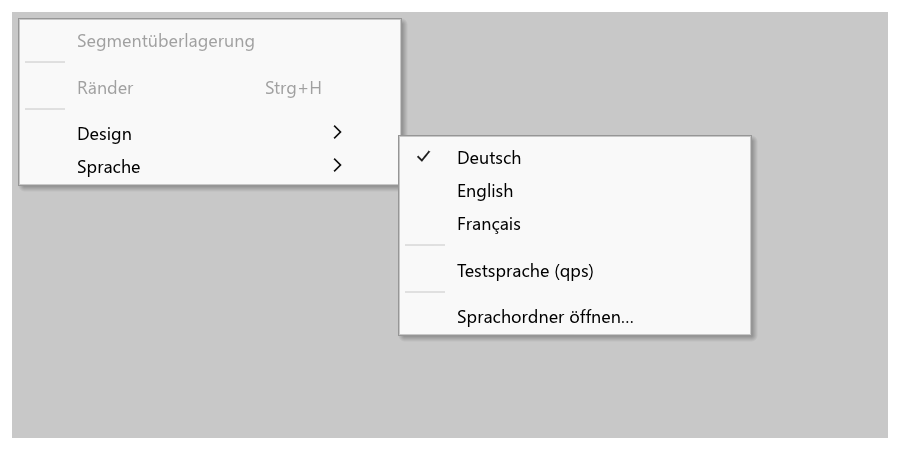

# fp-i18n – Mehrsprachigkeit (Fluent)

Firepixel ist mehrsprachig: eingebaut sind **Deutsch** (Ausgangssprache) und **Englisch**; jede
weitere Sprache ist ein Ordner mit Textdateien und braucht **keine Codeänderung**. Gewechselt wird
in **Ansicht ▸ Sprache** (oder in den Voreinstellungen), sofort und ohne Neustart.



## Für Übersetzer: eine neue Sprache hinzufügen

### 1. Vorlage anlegen
```
firepixel-cli language template fr "%APPDATA%\Firepixel\Languages"
```
legt `%APPDATA%\Firepixel\Languages\fr\*.ftl` an – eine Kopie der englischen Texte (`--from de`
nimmt Deutsch als Vorlage). Sprachcodes nach BCP 47: `fr`, `es`, `it`, `pt-BR`, `zh-TW`, `ja` …
Ohne Kommandozeile: den Ordner `crates\fp-i18n\locales\en\` kopieren und umbenennen.

### 2. Übersetzen
Jede Zeile ist `schlüssel = Text`. Nur **rechts vom `=`** übersetzen:

```ftl
# allgemein.ftl
language-name = Français              # Eigenname der Sprache, so erscheint sie im Menü
btn-cancel = Annuler
btn-yes = &Oui                        # & vor dem Buchstaben = Zugriffstaste (Alt+O)
key-ctrl = Ctrl                       # Tastennamen in Kürzeln (Strg+S → Ctrl+S)
fmt-decimal-separator = ,             # Dezimaltrennzeichen: 12,5 %
fmt-date = { $day }/{ $month }/{ $year }

# dialoge.ftl – Platzhalter { $name } unverändert übernehmen, Stelle frei wählbar
dlg-unsaved-text = Enregistrer les modifications de « { $name } » ?

# Mehrzahl: Varianten nach den Regeln der Sprache (one, few, many, other …), *[other] ist Pflicht
test-layers = { $n ->
    [one] { $n } calque
   *[other] { $n } calques
}
```

Regeln:
- Schlüssel links, Platzhalter `{ $name }` und Funktionen wie `{ NUMBER($z, maximumFractionDigits: 1) }` **nicht** übersetzen.
- `&` markiert die Zugriffstaste; `&&` ist ein wörtliches `&`. Im selben Menü bzw. Dialog keine Taste doppelt vergeben (die Prüfung meldet es).
- Mehrzeilige Texte: Folgezeilen einrücken. Kommentare beginnen mit `#`.
- Fehlt ein Schlüssel, zeigt Firepixel den englischen Text (dann den deutschen). Man kann also schrittweise übersetzen.
- Fachbegriffe: [`GLOSSAR.md`](GLOSSAR.md) (Deutsch → Englisch, verbindlich für die eingebauten Sprachen; für weitere Sprachen eine gute Orientierung).
- Dateien als UTF-8 speichern.

### 3. Prüfen
```
firepixel-cli language check "%APPDATA%\Firepixel\Languages\fr"
```
meldet je Datei:Zeile **Fehler** (Syntax, doppelte Schlüssel, Platzhalter, die das Programm nicht
kennt) und **Warnungen** (fehlende/verwaiste Schlüssel, fehlende Platzhalter oder Zugriffstasten,
doppelte Zugriffstasten in einem Menü/Dialog) und den übersetzten Anteil. `--kurz` zählt fehlende
Schlüssel nur, `--json` liefert alles maschinenlesbar, `--streng` wertet Warnungen als Fehler.
`firepixel-cli language list` zeigt alle Sprachen mit Vollständigkeit.

### 4. Benutzen
Der Ordner wird beim Start geladen aus
- `%APPDATA%\Firepixel\Languages\` (je Benutzer; **Ansicht ▸ Sprache ▸ Sprachordner öffnen...** öffnet ihn und lädt Änderungen sofort nach) und
- `Languages\` neben `firepixel.exe` (tragbare Installation).

Alte Ordner `Sprachen` (bis 12.10.2026) werden beim Start einmal in `Languages` umbenannt bzw.,
wenn das nicht geht, weiter gelesen (`fp_i18n::paths`). Die alten Befehle `sprache pruefen|vorlage|liste`
und Optionen `--eingebaut`, `--kurz`, `--streng`, `--ueberschreiben`, `--von` gehen weiter.

Erlaubt sind ein Unterordner je Sprache (`fr\*.ftl`) oder eine einzige Datei `fr.ftl`. Gleiche
Schlüssel überschreiben eingebaute Texte – so lassen sich auch einzelne deutsche oder englische
Texte anpassen (`de\eigene.ftl`).

**Fest einbauen** (für Entwickler): den Ordner nach `crates\fp-i18n\locales\<code>\` legen und neu
bauen. `build.rs` bettet alle Dateien ein; die exe bleibt eine einzelne Datei.

### Testsprache
`qps` (im Debug-Build bzw. mit der Voreinstellung `DeveloperOptions` unter Ansicht ▸ Sprache) zeigt
jeden Text markiert und um etwa 40 % verlängert: `[!! Abbrechen ····!!]`. Unübersetzte, fest
eingebaute Texte fallen sofort auf, und Layouts werden mit langen Texten geprüft.

### Schriften und Schreibrichtung
- Lateinisch, Kyrillisch, Griechisch: Segoe UI (geprüft im Test `i18n_sprachwahl`).
- Chinesisch, Japanisch, Koreanisch: Systemschriften Microsoft YaHei, Yu Gothic, Malgun Gothic als Rückfall (die der aktuellen Sprache zuerst), zur Laufzeit geladen.
- **Rechts nach links (Arabisch, Hebräisch, Persisch, Urdu): nicht unterstützt.** egui setzt Text nur links→rechts und ohne Glyphenformung (keine Bidi-Umordnung, keine arabischen Verbindungsformen, kein gespiegeltes Layout). Solche Sprachdateien lassen sich laden, erscheinen im Menü mit „(RTL)“ markiert, sind aber kaum lesbar.

### Kommandozeile und MCP
- `firepixel-cli` spricht `--lang <code>`, sonst `FIREPIXEL_LANG`, sonst die Systemsprache; die Hilfe kommt vollständig aus `kommandozeile.ftl`.
- Der MCP-Server antwortet KI-Agenten in `FIREPIXEL_MCP_LANG` (Vorgabe Englisch, je Aufruf `language`), über `fp_i18n::with_language` nur im Thread des Aufrufs; die Oberfläche bleibt in ihrer Sprache.

## Für Entwickler
- Jeder für Nutzer sichtbare Text kommt aus `fp_i18n::t("schluessel")` bzw. `fp_i18n::tr!("schluessel", name = wert)`. **Keine festen Texte in UI-Code.** Ausnahmen: Eigennamen (Firepixel, Dateiformate wie PNG/WebP), Einheiten-Kürzel (px, %), reine Symbole.
- Texte werden in jedem Frame neu geholt; Sprachwechsel wirken sofort. Wer Texte selbst zwischenspeichert, koppelt den Cache an `fp_i18n::generation()`.
- Menüs/Befehle: Schlüssel = `fp_i18n::command_key(name)` (`file.open` → `cmd-file-open`), Attribute `.tooltip`, `.description` optional.
- Neuer Text = Schlüssel in **`de` und `en` gleichzeitig** anlegen (Tests `builtin_files_are_complete_and_clean`, `builtin_placeholders_and_access_keys`). Englische Begriffe nach `GLOSSAR.md`.
- Zahlen **als Zahl** übergeben (`tr!("x", n = 12.5)`): Dezimaltrennzeichen der Sprache, höchstens 3 Nachkommastellen, Mehrzahlwahl nach CLDR. Stellen in der .ftl: `{ NUMBER($n, minimumFractionDigits: 1, maximumFractionDigits: 2) }`. Keine Tausendertrennung.

### Hilfen (alle folgen der aktuellen Sprache)
| Funktion | Zweck |
|---|---|
| `t(key)` / `tr!(key, a = x)` / `t_args` | Text, Text mit Platzhaltern |
| `t_arc(key)` | wie `t`, ohne neue Zeichenkette (`Arc<str>`) |
| `strip_access("&Datei")` → `("Datei", Some('d'))`; `t_access(key)` | Zugriffstaste und Anzeigetext (`AccessText { text, key, index }`, `index` = Zeichenindex zum Unterstreichen) |
| `shortcut_label("Strg+Umschalt+S")` | Kürzel in der Sprache (nimmt deutsche oder englische Schreibweise; Tastennamen `key-*`) |
| `unit("px")`, `unit("ppi")` | Einheiten (`unit-*`) |
| `fmt_decimal(v, n)`, `fmt_number(v, min, max)` | Zahlen mit Dezimaltrennzeichen |
| `fmt_size(bytes)` | „1,5 MB“ / „1.5 MB“ |
| `fmt_date(y, m, d)`, `fmt_time(h, m)`, `fmt_datetime(…)` | Datum/Uhrzeit (`fmt-date` …) |
| `languages()`, `set_language(code)`, `current_language()`, `system_language()` | Sprachen |
| `load_external_dir(dir)`, `load_default_dirs()`, `user_language_dir()` | Sprachordner |
| `check::check_builtin()`, `check::check_path(p)` | Prüfungen (Tests, CLI) |

Oberfläche: `fp_ui::language` (Untermenü, `switch`, `init` beim Start, `pref_row` für die
Voreinstellungen, Voreinstellungsschlüssel `Language` und `DeveloperOptions`).

### Leistung
`t()` läuft je Frame tausendfach. Jeder Thread hat einen eigenen Lese-Cache (Schlüssel → Text),
der an einem atomaren Generationszähler hängt: im Normalfall **keine Sperre und kein Fluent**,
nur ein Hash-Nachschlagen (FxHash). Texte mit Platzhaltern werden je Thread mit ihren Werten
zwischengespeichert (höchstens 4096 Einträge). Messung (`cargo test -p fp-i18n --release --test
leistung -- --ignored --nocapture`, 12.10.2026, Maschine durch parallele Builds belastet; Minimum aus 5 Läufen):

| Aufruf | früher (RwLock + Map) | jetzt |
|---|---|---|
| `t()` (inkl. neuer `String`) | 110 ns | 80–110 ns (die Zuweisung der `String` dominiert; egui braucht sie ohnehin) |
| Nachschlagen allein (`t_arc`) | – | 21 ns |
| `has()` | ohne Cache (Fluent je Aufruf) | 20–30 ns |
| `tr!` mit wiederkehrender Zahl | 1,6 µs | 0,2 µs |
| `tr!` mit Text-Platzhalter | 0,46 µs | 0,14 µs |
| 8 Threads gleichzeitig, `t()` | 0,9–1,1 µs | 0,45 µs |
| Frame mit 5000 Texten | – | ≈ 0,45 ms |
| Sprachwechsel + erster Frame | – | ≈ 0,6 ms |

### Prüfungen (dauerhaft)
- `fp-i18n`: Vollständigkeit de/en, keine verwaisten Schlüssel, Syntax, Platzhalter je Schlüssel gleich, keine neuen Zugriffstasten-Konflikte im Englischen.
- `fp-ui\tests\i18n_keine_festen_texte.rs`: Quelltext-Scanner für feste Texte im ganzen Workspace (UI-Aufrufe, deutsche Literale, Fehlermeldungen aller Bibliotheken, Ausgaben von Kommandozeile und MCP-Server) mit Ausnahmeliste `i18n_ausnahmen.txt`; meldet `Datei:Zeile` und „feste Texte übrig: N“; scharf seit UE-3 (`keine_festen_texte` muss 0 ergeben). Bericht: `cargo test -p fp-ui --test i18n_keine_festen_texte -- --ignored --nocapture` (Filter: `$env:FP_I18N_FILTER = 'menu.rs'`).
- `fp-ui\tests\i18n_sprachwahl.rs`: Menü, Wechsel ohne Neustart, Start mit gespeicherter/Systemsprache, Sprachordner, Schriftabdeckung.

## Schlüssel und Bereichsdateien
Schlüssel: Kleinbuchstaben, Bindestriche, Bereichspräfix. Attribute mit Punkt (`key.tooltip`). Fluent-Syntax: <https://projectfluent.org/fluent/guide/>.

| Datei (`locales\<code>\…`) | Präfixe | zuständig (Phase 6) |
|---|---|---|
| `allgemein.ftl` | `language-name`, `btn-`, `fmt-`, `unit-`, `key-` (Tastennamen), `lang-` (Sprachwahl), `test-` | I18N-KERN |
| `menue.ftl` | `menu-` (Menütitel, Untermenüs), `cmd-` (alle Befehle aus dem Register inkl. Tooltip), `ctx-` (Kontextmenüs), `pmenu-` (Bedienfeldmenüs) | I18N-MENUE |
| `werkzeuge.ftl` | `tool-` (Werkzeugnamen, Tooltips, Flyouts, Statushinweise), `shape-` (automatische Formen) | I18N-MENUE |
| `dialoge.ftl` | `dlg-` | I18N-DIALOGE |
| `inspektor.ftl` | `pi-` | I18N-INSPEKTOR |
| `bedienfelder.ftl` | `panel-` | I18N-BEDIENFELDER |
| `oberflaeche.ftl` | `ui-` (Anwendungsleiste, Symbolleiste, Reiter, Leinwand-Overlays, Statuszeile, Fußleiste, Docking, Datei-Dialogfilter, Startfenster) | I18N-SHELL |
| `meldungen.ftl` | `err-` (Fehler aus fp-engine/fp-io/fp-export/fp-script), `msg-` (Status-/Infomeldungen), `ai-` (KI-Auswahl) | I18N-ENGINE |
| `filter.ftl` | `filter-`, `effect-`, `blend-` (Filter-, Effekt- und Mischmodusnamen, Parameter) | I18N-ENGINE |
| `willkommen.ftl` | `welcome-` (Startbildschirm) | DESIGN |
| `skript.ftl` | `err-script-` (Meldungen aus fp-script: automatische Formen, Dateien) | AU |
| `mcp.ftl` | `msg-mcp-`, `err-mcp-` (Antworten des MCP-Servers und der Brücke an KI-Agenten), `mcp-tool-` (Werkzeugtitel, `.description`, Parameter), `mcp-res-` (Ressourcen), `mcp-doc-arg` | AU, UE-3 |
| `kommandozeile.ftl` | `cli-` (Hilfe von `firepixel-cli`: `cli-<befehl>`, `.examples`, `cli-<befehl>-arg-<option>`, `.value`; Meldungen; `cli-lang-*`, `cli-check-*` Sprachprüfung) | UE-3 |
| `befehlstexte.ftl` | `cmdtext-` (Parameterbeschreibungen und Hinweise der Befehle für MCP/CLI; Schlüssel aus dem deutschen Quelltext, `fp_engine::command::source_text_key`) | UE-3 |
| `dateidialog.ftl` | `fdlg-` (Datei-Dialog in der App bei aktivem KI-Steuerkanal) | AU |
| `image_preview.ftl` | `image-preview-` (Bildvorschau, Datei ▸ Bildvorschau…; die Beschriftungen der linken Spalte stehen in `dialoge.ftl` unter `dlg-preview-`) | BV-<n> |
| `nachzeichnen.ftl` | `trace-` (Bitmap nachzeichnen; die Befehlsbeschriftung steht in `menue.ftl` unter `cmd-modify-traceBitmap`) | VT-<n> |

Jeder Agent schreibt nur in seine Dateien (in `de` **und** `en`).

Gruppen für die Zugriffstasten-Prüfung (`check::access_group`): `menu-…`/`cmd-…` nach Menüpfad
(Schlüssel ohne Präfix bis zum letzten `-`: `cmd-modify-align-left` und `menu-modify-align` liegen
in `modify-align` bzw. `modify`), `dlg-<dialog>-…` je Dialog, `btn-…` gemeinsam, sonst bis zum
letzten `-`.
