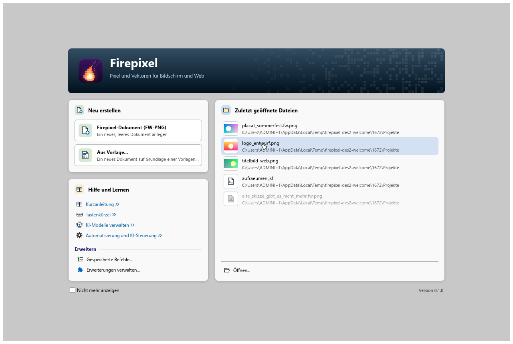
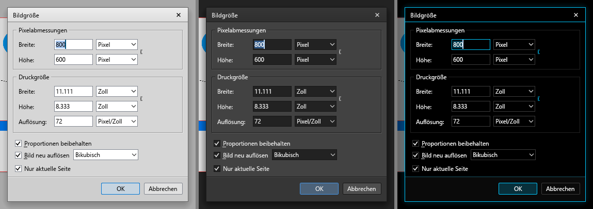

# Gestaltung von Fenstern, Dialogen und Modalen (Agent DESIGN, ab 12.10.2026)

Nutzerwunsch: Fenster und Modale, die funktionieren, aber „ohne Liebe“ aussehen, werden schöner.
Dieses Dokument enthält die **Gestaltungsregeln** (verbindlich für neue und überarbeitete Fenster),
die **gemeinsamen Bausteine** (`crates\fp-ui\src\ui_kit.rs`) und die **Bestandsaufnahme mit
Prioritätenliste**.

Bilder: `docs\screenshots\design_before_*.png` (Stand vor der Überarbeitung) und
`design_after_*.png`; je Bild die drei Designs nebeneinander (**Normal | Dunkel | OLED**).
Bis TE-2 (13.10.2026) hießen sie `design_vorher_*`/`design_nachher_*`; die vorhandenen Bilder
behalten ihre Namen.
Erzeugen: `cargo test -j 4 -p fp-ui --test all design_bilder:: -- --ignored --nocapture` mit
`FP_DESIGN_IMAGE=before|after` (alt `FP_DESIGN_BILD=vorher|nachher`, wird weiter gelesen;
Startbildschirm: `--test all design_willkommen:: -- --ignored`).

---

## 1. Grundsätze

1. **Nähe zum Original bleibt Pflicht.** Dialoge, die es im Original gibt (Leinwandgröße,
   Bildgröße, Neues Dokument, Voreinstellungen, Export, Tonwertkorrektur, Kurven, Filter- und
   Effektdialoge, Tastenkürzel, Rechtschreibung, Pop-up-Menü-Editor …), behalten **Aufbau,
   Reihenfolge der Felder, Beschriftungen und Bedienung** (Tab-Reihenfolge, Standardknopf,
   Zugriffstasten, Eingabe/Esc). Überarbeitet wird nur die Ausführung: Abstände, Ausrichtung,
   Gruppenrahmen, Kopf, Knopfleiste, Farben, Zustände. Wortlaut und Bedienung bleiben gleich; ihre
   Tests bleiben grün.
2. **Eigene Firepixel-Fenster** (KI-Modelle, KI-Modell fehlt, Sprache, MCP-Steuerkanal,
   Startbildschirm, Meldungen) folgen diesen Regeln frei.
3. **Keine festen Texte.** Alle Bausteine nehmen Texte als Parameter; die Aufrufer holen sie über
   `fp_i18n::t`. Neue Texte in `de` und `en` gleichzeitig (Regeln §1b).
4. **Farben ausschließlich aus dem Theme** (`theme.rs`, `Theme::current(ctx)`), keine Farbwerte im
   Dialogcode. Abgeleitete Töne nur über `theme::mix`/`with_alpha` bzw. `ui_kit::tint`/`card_bg`.
5. **Clean Room**: eigene Symbole (`icons.rs`, `ui_kit::KitIcon`), eigenes Logo
   (`assets\icon`), keine Grafiken oder Markenzeichen des Originals; Neutralitätsregel §1a.

## 2. Raster, Abstände, Ränder

Alles liegt auf einem **8er-Raster** (`ui_kit::sp`):

| Konstante | Wert | Verwendung |
|---|---|---|
| `sp::XS` | 4 | Symbol ↔ Text in dichten Zeilen, Titel ↔ Erklärsatz |
| `sp::S` | 8 | Abstand innerhalb einer Gruppe, zwischen Knöpfen, unter Abschnittsüberschriften |
| `sp::M` | 12 | Beschriftung ↔ Feld, Innenabstand von Hinweisblöcken und Kopfbereichen |
| `sp::L` | 16 | **Dialogrand**, Abstand zwischen Abschnitten |
| `sp::XL` | 24 | großzügige Flächen (Startbildschirm, Spaltenabstand) |
| `sp::ROW` | 24 | Zeilenhöhe Beschriftung-Wert und Listen |
| `sp::BUTTON_H` | 23 | Knopfhöhe (wie bisher) |

- Dialogrand ringsum 16 px; nichts klebt am Rand oder an der Titelleiste.
- Elemente einer Zeile sind **senkrecht mittig** ausgerichtet, Beschriftungen einer Spalte
  **linksbündig auf einer Kante**.
- Gruppenrahmen (`dialogs::group_box`) nur, wo das Original sie hat; sonst Abschnitte (§4).
- Dialoge, deren Inhalt wachsen kann (Listen, Tabellen, lange Texte), sind
  **größenveränderlich** (`dialog_frame_resizable`) oder scrollen; feste Dialoge berechnen ihre
  Größe aus den Textbreiten (`dialogs::extra_w`, `buttons_w`), nie umgekehrt.

## 3. Kopfbereich je Dialogart

| Art | Kopf | Beispiele |
|---|---|---|
| **Einstellungsdialog des Originals** | kein zusätzlicher Kopf (wie im Original); nur Titelleiste | Leinwandgröße, Bildgröße, Filter, Effekte, Tonwert, Kurven |
| **Eigenes Verwaltungsfenster** | `ui_kit::dialog_header`: Symbol 32 px, Titel 15 px fett, Erklärsatz (umbrochen, gedämpft), Kartenfläche, geätzte Linie | KI-Modelle verwalten, Sprache, MCP-Steuerkanal, Gespeicherte Befehle |
| **Rückfrage / Meldung** | Symbol 32 px links (Info/Warnung/Fehler, `KitIcon`), Text rechts daneben, kein Titel im Inhalt (steht in der Titelleiste) | Ungespeichert, Bestätigen, Meldung |
| **Info-Fenster** | App-Logo (`HeaderIcon::App`), Name, Version | Über Firepixel |

## 4. Abschnitte und Trennlinien

- `ui_kit::section(ui, titel)`: Überschrift **12 px fett in `section_label`**, danach eine geätzte
  Linie bis zum rechten Rand; darunter 4 px, dann der Inhalt. Abstand zum nächsten Abschnitt 16 px.
- `ui_kit::separator` / `hline` / `vline`: geätzte Linie (dunkel + Lichtkante) im Normal- und
  Dunkel-Design, eine feine Linie im OLED-Design. Keine dreifachen Splitter-Linien in Dialogen
  (die gehören zu Docks).

## 5. Beschriftung-Wert-Raster

- Beschriftungsspalte = breiteste Beschriftung + 12 px (`ui_kit::label_width`), für **alle Zeilen
  eines Abschnitts gleich**; Felder beginnen auf derselben Kante.
- Zeilenhöhe 24 px, Feldhöhe 20–22 px, senkrecht mittig (`ui_kit::kv_row`).
- Einheiten (px, %, °) direkt rechts vom Feld mit 4 px Abstand, gedämpft.
- Zu lange Beschriftungen (andere Sprachen) werden mit „…“ gekürzt **und** als Überlauf gemeldet
  (`dialogs::report_overflow`) – das Layout soll sie aber durch `label_width` gar nicht erst kürzen.

## 6. Knopfleiste

- `ui_kit::button_bar`: am unteren Rand, geätzte Linie darüber, Innenabstand 12 px.
- **Rechts** die Hauptknöpfe in Windows-Reihenfolge: **OK (Standardknopf, Rahmen in `focus`)**,
  Abbrechen, ggf. Übernehmen. **Links** Nebenknöpfe (Hilfe, Zurücksetzen, Vorschau-Schalter).
- Alle Knöpfe einer Leiste **gleich breit** (längste Beschriftung + 12 px, mindestens 76 px),
  Höhe 23 px, Abstand 8 px.
- Eingabetaste löst den Standardknopf aus, Esc bricht ab (über `dialogs::push_button`).
- Dialoge des Originals mit Knöpfen rechts oben (z. B. Tonwert, Kurven: OK/Abbrechen/Auto rechts
  neben dem Inhalt) **behalten** diese Lage; vereinheitlicht werden dort nur Breite, Höhe, Abstand.

## 7. Hinweis- und Warnblöcke

`ui_kit::notice(ui, Tone, titel, text)`: getönte Fläche (`ui_kit::tint`), 3 px Leitstreifen links
in der Tonfarbe, Symbol 16 px, optional fetter Titel, umbrochener Text. Töne: `Info` (`focus`),
`Warning` (`icon_yellow`), `Error` (`icon_red`), `Success` (`icon_green`). Fehler und Warnungen in
Dialogen nie nur als roter Text ohne Fläche.

## 8. Tabellen und Listen

`ui_kit::table`: Kopf im Bedienfeld-Kopfstil (`widgets::header_bar`, 22 px, fett 11 px), Spalten
mit feinen Trennern, Zeilen 22–24 px, **Zebrastreifen** (`ui_kit::zebra`), **Hover**
(`list_hover_bg`), **Auswahl** (`list_selected_bg`/`list_selected_text`, OLED mit Akzentrand),
senkrechter Bildlauf, Zellentext mit „…“ und Tooltip (`ui_kit::cell_text`). Zahlen rechtsbündig
(`Column::right`). Rahmen in `list_border`.

## 9. Leere Zustände und Fortschritt

- **Leer**: `ui_kit::empty_state` – gedämpftes Symbol 32 px, Titel (fett, gedämpft), Hinweis was
  zu tun ist (klein). Nie eine leere weiße Fläche ohne Erklärung.
- **Fortschritt**: `ui_kit::progress` – Balken 8 px, abgerundet, Füllung `focus`, Text darüber;
  unbestimmt = wandernder Abschnitt. Abbrechen-Knopf rechts in der Knopfleiste.

## 10. Farben und Typografie

| Rolle | Farbe (Palette) |
|---|---|
| Dialogfläche | `frame_bg` |
| Karte, Kopfbereich, Startbildschirm | `ui_kit::card_bg` (= `menu_bg`) |
| Text / gedämpft / gesperrt | `text` / `text_weak` / `text_disabled` |
| Abschnittsüberschrift | `section_label` |
| Link | `focus` (Normal leicht abgedunkelt) |
| Linien | `line_dark`, `line_mid`, `line_light` (über `ui_kit::hline`) |
| Fokus, Standardknopf, Fortschritt | `focus` |

| Stufe (`ui_kit::type_scale`) | Größe | Gewicht | Verwendung |
|---|---|---|---|
| `CAPTION` | 11 | normal / fett | Tabellenköpfe, Hinweise unter Feldern, Fußzeilen |
| `BODY` | 11,5 | normal | Beschriftungen, Felder, Fließtext (= `fonts.ui`) |
| `SECTION` | 12 | fett | Abschnittsüberschriften |
| `TITLE` | 15 | fett | Titel im Kopfbereich |
| `DISPLAY` | 30 | fett | Programmname im Startbildschirm |

Nur diese Stufen; keine kursiven oder farbigen Fließtexte (außer Links und Hinweisblöcken).

## 11. Verhalten in den drei Designs

- **Normal**: hellgrau wie das Original; Karten fast weiß, geätzte Linien, Verläufe in Köpfen.
- **Dunkel**: gleiche Gliederung in dunklen Grautönen; Karten etwas dunkler als die Fläche.
- **OLED**: reines Schwarz; Linien einfach und fein; Fokus, Auswahl, Hover und Kopfbereiche mit
  Akzentschein (`theme.glow`); Symbole farbig. Kein Grau-auf-Schwarz unter 4,5:1 Kontrast für Text.
- Jedes überarbeitete Fenster wird in allen drei Designs, in Deutsch, Englisch und `qps`, bei
  1024×768 und 1920×1080 sowie 100 % und 150 % geprüft (keine Überläufe, nichts abgeschnitten).

## 12. Umsetzung: Startbildschirm und Dialograhmen (Stand 13.10.2026)

Die Regeln in §12.1–§12.3 gelten jetzt. Neue und überarbeitete Fenster halten sich daran. Die
Werte stehen im Code als Konstanten bzw. Theme-Funktionen und werden dort geändert, nicht hier.

### 12.1 Startbildschirm (DES-2, `a728586`, `crates\fp-ui\src\welcome.rs`)

Aufbau (ersetzt den ersten Entwurf „zwei Spalten in einer Karte“):

- **Kopfbanner**: abgerundetes Banner mit dem eigenen Flammen-Pixel-Logo (`assets\icon`),
  „Firepixel“ und Leitsatz. Das Pixelfeld wird nach rechts dichter. Logo 64 px, im schmalen
  Fenster 48 px, sehr schmal 36 px. Im OLED-Design leuchtet der Rand. `paint_banner` nutzt auch
  „Über Firepixel“.
- **Drei Karten**:
  - **Neu erstellen**: zwei große Einträge (Firepixel-Dokument, Aus Vorlage...), Höhe 54 px, mit
    Symbolchip, fettem Titel und gedämpfter Erklärung (vorhandene `.tooltip`-Texte).
  - **Zuletzt geöffnete Dateien**: bis 8 Zeilen à 44 px mit Vorschaubild 36 px (PNG/FW-PNG, JPEG,
    BMP, QOI; Schachbrett hinter Transparenz; sonst Symbol der Dateiart). Darunter steht der
    Ordner gedämpft, in der Mitte gekürzt. Fehlende Dateien sind gedämpft, der Tooltip zeigt den
    vollen Pfad. Es gibt einen leeren Zustand. „Öffnen...“ steht unten in der Karte. Die
    Vorschaubilder werden im Hintergrund gelesen (`welcome\thumbs.rs`), zwischengespeichert nach
    Pfad und Änderungszeit; Dateien über 48 MB werden nicht gelesen.
  - **Hilfe und Lernen**: vier »-Links (Kurzanleitung, Tastenkürzel, KI-Modelle,
    Automatisierung), Höhe 26 px; darunter Abschnitt „Erweitern“ (Gespeicherte Befehle,
    Erweiterungen; nur wenn der Befehl registriert ist).
- **Fußzeile** 28 px: „Nicht mehr anzeigen“ links (Voreinstellung `ShowStartPage`), Version rechts.
- **Maße**: höchstens 940 px breit, Abstand zwischen Karten und Innenrand je `sp::L` (16 px),
  Kartenkopf 34 px, Eckenradius 8 px. Zwei Spalten ab 600 px Inhaltsbreite, darunter einspaltig
  in der Reihenfolge Neu, Zuletzt, Hilfe; Bildlauf, wenn die Höhe nicht reicht.
- **Zustände**: Hover getönt in der Leitfarbe der Karte, Handcursor; Fokusrahmen in `focus` für
  jeden Eintrag. **Tastatur**: Tab/Umschalt+Tab, Pfeiltasten auch zwischen den Spalten,
  Eingabe/Leertaste lösen aus.
- **Designs**:
  - Normal: helle Karten (`ui_kit::card_bg`) mit weichem Schatten (Versatz 2 px, Weichzeichnung
    10 px) auf der grauen Fläche.
  - Dunkel: Karten heller als die Leinwand, sonst verschwinden sie.
  - OLED: schwarz, kein Schatten. Jede Karte hat einen eigenen Leuchtrand und einen Titel in ihrer
    Gruppenfarbe (grün, cyan, orange). Die Symbole sind farbig.

| Design | Deutsch | Englisch |
|---|---|---|
| Normal (hell) | [N11_start_normal_de](screenshots/nutzerbefunde/N11_start_normal_de.png) | [N11_start_normal_en](screenshots/nutzerbefunde/N11_start_normal_en.png) |
| Dunkel | [N11_start_dunkel_de](screenshots/nutzerbefunde/N11_start_dunkel_de.png) | [N11_start_dunkel_en](screenshots/nutzerbefunde/N11_start_dunkel_en.png) |
| OLED | [N11_start_oled_de](screenshots/nutzerbefunde/N11_start_oled_de.png) | [N11_start_oled_en](screenshots/nutzerbefunde/N11_start_oled_en.png) |

Je 1280 × 860, mit Vorschaubildern und Hover über einer Datei. Erzeugen:
`cargo test -p fp-ui --test all welcome_des2::n11_start_bilder -- --ignored`.
Vorher: [design_vorher_startbildschirm](screenshots/design_vorher_startbildschirm.png).
Die Bilder `design_nachher_startbildschirm*.png` zeigen noch den ersten Entwurf (vor DES-2) und
gelten nicht mehr als Nachweis.

### 12.2 Dialograhmen (DES-1, `4109217`, `dialogs\mod.rs`, `theme.rs`)

Die Gestaltung sitzt zentral im Rahmen (`dialog_frame_ex`) und in den gemeinsamen Bausteinen.
Einzelne Dialoge brauchen dafür keinen eigenen Code. Bedienung, Beschriftungen, Lage und Größe
der Felder und Knöpfe sowie die Dialoggrößen bleiben gleich.

- **Fußleiste** hinter der unteren Knopfzeile (`footer_top`):
  - Zur unteren Knopfzeile zählen Knöpfe aus `push_button`, die bis auf 18 px an die Unterkante
    des Inhalts reichen.
  - Die Leiste beginnt 12 px über der Knopfzeile, aber mindestens 3 px unter allem Gezeichneten
    darüber. Bleiben weniger als 5 px über den Knöpfen, entfällt sie.
  - **Keine Leiste**, wenn etwas Gezeichnetes oder ein anderer Knopf in die Knopfzeile ragt
    (Knöpfe rechts untereinander wie bei den Filtern, Liste bis unten). Die Anordnung des
    Originals hat Vorrang.
  - Fläche `dialog_footer_bg`, oben eine geätzte Linie `dialog_footer_lines` (dunkle Linie +
    Lichtkante; OLED nur eine Linie). Sie wird in einen vor dem Inhalt reservierten Platz
    gezeichnet und liegt daher unter allem.
  - `ui_kit::button_bar` zeichnet keine eigene Linie mehr und meldet seine Leiste über
    `dialogs::set_footer` (Rückfrage, Warnung, Über, Bitmap nachzeichnen). „Ungespeichert“ hat
    keine eigene Linie mehr.
- **Titelleiste**: Verlauf `dialog_title_gradient`, 1 px Linie `dialog_title_line` darunter.
  Dunkel ist sie jetzt klar dunkler als die Fläche (Befund §13: „kaum Kontrast“). OLED: schwarz,
  Linie in `focus`.
- **Schatten** `dialog_shadow`: Normal Versatz 6 px, Weichzeichnung 20 px, Schwarz α 70; Dunkel
  6 px / 22 px / α 160; OLED statt Schatten Akzentschein in `focus` (α 46, 18 px, Ausdehnung 1 px).
  Lage und Rechteck des Dialogs bleiben unverändert.
- **Standardknopf (OK)** `default_button_fill`: Knopffläche in Richtung `focus` gemischt, Normal
  12 % (unter der Maus 20 %), Dunkel 28 % (40 %), OLED 20 % (32 %). Der Fokusrahmen bleibt.
- **Gruppenrahmen** `group_box_lines`: geätzt wie ein Windows-Gruppenfeld (dunkle Linie +
  Lichtkante); OLED fein, eine Linie.
- **Abschnittsüberschrift im Formular** (`FieldKind::Caption`, `form.rs`): Farbe `section_label`,
  geätzte Linie (§4).
- Alle Tokens sind aus der Palette abgeleitet (`impl Theme`-Block „Dialoge (DES-1)“ am Ende von
  `theme.rs`). Es gibt keine eigenen Farbwerte.

Bilder: je Bild **Normal | Dunkel | OLED** nebeneinander, links vorher (Stand `42dabe7`),
rechts nachher. Erzeugen: `FP_DES1_STAGE=before|after cargo test -p fp-ui --test all
dialogs_des1::des1_images -- --ignored`.

| Dialog | Vorher | Nachher | Hinweis |
|---|---|---|---|
| Meldung | [vorher](screenshots/des1/before_message.png) | [nachher](screenshots/des1/after_message.png) | Info-Symbol von NZ-3, jetzt mit Fußleiste |
| Rückfrage „Verlauf löschen“ | [vorher](screenshots/des1/before_confirm_history_clear.png) | [nachher](screenshots/des1/after_confirm_history_clear.png) | `button_bar` als Fußleiste |
| Warnung „kein Ziel“ | [vorher](screenshots/des1/before_warning_no_target.png) | [nachher](screenshots/des1/after_warning_no_target.png) | |
| Ungespeichert | [vorher](screenshots/des1/before_unsaved.png) | [nachher](screenshots/des1/after_unsaved.png) | eigene Linie entfernt |
| Arbeitsbereich speichern | [vorher](screenshots/des1/before_save_workspace.png) | [nachher](screenshots/des1/after_save_workspace.png) | |
| Bildgröße | [vorher](screenshots/des1/before_image_size.png) | [nachher](screenshots/des1/after_image_size.png) | geätzte Gruppenrahmen |
| Leinwandgröße | [vorher](screenshots/des1/before_canvas_size.png) | [nachher](screenshots/des1/after_canvas_size.png) | |
| Neues Dokument | [vorher](screenshots/des1/before_new_document.png) | [nachher](screenshots/des1/after_new_document.png) | |
| Gaußscher Weichzeichner | [vorher](screenshots/des1/before_gaussian_blur.png) | [nachher](screenshots/des1/after_gaussian_blur.png) | Knöpfe rechts oben → **keine** Leiste |
| Voreinstellungen | [vorher](screenshots/des1/before_preferences.png) | [nachher](screenshots/des1/after_preferences.png) | **keine** Leiste (Liste reicht bis 3 px an die Knopfzeile), offen → DES-3 |

### 12.3 Nichts abschneiden: Dialoge im Fenster (RAND-2a `21edb24`, RAND-2b `247ce0c`)

- **Ein Dialog liegt immer ganz im Hauptfenster.** Ist er größer, wird seine sichtbare Größe auf
  das Fenster begrenzt. Der Inhalt behält seine volle Größe und läuft in einem Bildlaufbereich in
  beide Richtungen (`scrolled_body`). Mausrad und Bildlaufleiste blättern.
- **Feste Knopfzeile**: Unten bleibt ein Streifen von 48 px stehen (`DIALOG_PIN_STRIP`, höchstens
  die halbe Inhaltshöhe). `push_button` verschiebt Knöpfe aus dem unteren Inhaltsstreifen dorthin:
  rechte bleiben rechts, linke („Hilfe“) links. OK, Abbrechen, Hilfe und Schließen sind immer
  sichtbar und bedienbar; Enter löst den Standardknopf aus, der Fokus bleibt gleich. Dieser Streifen
  ist zugleich die Fußleiste aus §12.2, mit einfacher statt geätzter Linie.
- Dialoge, die passen, bleiben unverändert (kein zweiter Code-Pfad).
- **Waagerechter Bildlauf in schmalen Bereichen** (Inspektor): Die Bildlaufleiste schwebt über
  dem Inhalt und belegt keine Höhe. In Ruhe ist sie 3 px breit (Deckkraft 0,7), unter der Maus
  6 px. Das Mausrad blättert ohne Umschalttaste waagerecht, wenn nur diese Richtung geht.
- **Listen** reichen nie über eine Fußleiste. Ist ein Bedienfeld zu niedrig, wird die Liste
  kleiner (kein Mindestwert der Bildlaufhöhe).
- Menüs folgen derselben Regel: Sie werden auf das Fenster begrenzt und haben Pfeilleisten (MN-6
  `a6fd9d3`).
- **Prüfer**: `crates\fp-ui\tests\clipping_audit.rs` prüft alle Bedienfelder, den Inspektor, die
  Dialoge, die Startseite, die Menüs und die Tooltips in 24 Varianten (3 Designs × de/en ×
  100/150 % × Fenster 1024 × 768 und 1920 × 1080). Ein Text, der genau an der Kante eines Bildlaufbereichs angeschnitten
  ist, gilt als `hinweis-bildlauf` und nicht als Fehler. Neue Fenster müssen dort **0 Funde**
  haben. Die Erlaubnisliste `clipping_audit_allow.txt` wird nicht erweitert, sondern abgebaut.
  Tests zur Regel: `dialog_scroll_rand2b` (800 × 512: Dialog im Fenster, OK unten wirkt).

---

## 13. Bestandsaufnahme (vorher) und Prioritäten

Bestand am 12.10.2026: **79 Bilder** (`design_vorher_*.png`) – Startbildschirm, 71 über Menüs,
Bedienfeldmenüs und Kontextmenüs erreichbare Dialogarten (automatisch gefunden, Liste in
`target-design\design-qa\dialoge.json`) und die 7 Seiten der Voreinstellungen, je Normal | Dunkel | OLED.

Gesamteindruck vorher: Die Dialoge des Originals (Neues Dokument, Leinwand-/Bildgröße, Numerisch,
Tonwert, Kurven, Filter) sind ordentlich und nah am Vorbild. „Lieblos“ wirkten vor allem die
**eigenen und generischen Fenster**: Meldungen ohne Symbol, Rückfragen ohne Gliederung, Listen ohne
Kopf und leere Zustände, große Leerflächen, uneinheitliche Knopfbreiten. Das Dunkel-Design hatte
kaum Kontrast zwischen Titelleiste und Fläche; OLED war stimmig.

**Stand 13.10.2026 (N11):** Startbildschirm und Dialograhmen sind erledigt (DES-2, DES-1). Alle
Dialoge bekommen Fußleiste, Titelleiste, Schatten und getönten OK-Knopf automatisch. Offen
bleiben die Tabellen und Listen einzelner Dialoge (Prio 5–11), die Fußleiste der Voreinstellungen
und die einheitlichen Knopfbreiten → künftiges Paket **DES-3**. N11 bleibt bis dahin „teilweise“.

| Prio | Fenster (Datei) | Befund (vorher) | Maßnahme | Stand |
|---|---|---|---|---|
| 1 | **Startbildschirm** (`welcome.rs`) | Überschrift + zwei Spalten blauer Textlinks, sonst leer | Banner, drei Karten mit Vorschaubildern, Tastatur (§12.1) | **erledigt** DES-2 `a728586` |
| 2 | **Meldung** (`dialogs\mod.rs::show_message`; Datei-Info, Rechtschreibung, Pop-up-Menü, Optimieren) | kein Symbol, Text klebt oben links, „Schlüssel: Wert“-Zeilen als Fließtext (Datei-Info), viel Leerraum | Symbol 32 px, Text mittig am Symbol, Fußleiste | **erledigt**: Symbol NZ-3 `3a3342b`, Fußleiste DES-1 `4109217`; Wertepaare als Raster (Datei-Info) offen → DES-3 |
| 3 | **Rückfragen** (`misc.rs::Confirm`) | kein Symbol, Text ohne Abstand zur Titelleiste, Loch über den Knöpfen | Fußleiste über `button_bar` | **erledigt** DES-1 `4109217` |
| 4 | **Ungespeichert** (`unsaved.rs`) | Info-Symbol, Text nicht mittig, Leerraum | automatische Fußleiste statt eigener Linie | **erledigt** DES-1 `4109217` (Wortlaut unverändert) |
| 5 | **KI-Modelle verwalten** (`models.rs`) | Tabelle ohne Zebra/Hover, Kopf ohne Kopfstil, Gruppe „Speicherort“ gequetscht, Leerraum unten | `dialog_header`, `ui_kit::table`, Abschnitte, Knopfleiste | Rahmen/Fußleiste automatisch (DES-1), Bildlauf (RAND-2b); **Tabelle offen → DES-3** |
| 6 | **Gespeicherte Befehle verwalten** (`menu_dialogs.rs`) | nackte Liste ohne Kopf, ohne leeren Zustand, ohne Auswahlhervorhebung | Kopf, Tabelle (Name, Datei), leerer Zustand, Knöpfe einheitlich | **offen → DES-3** |
| 7 | **Über Firepixel** (`about.rs`) | flach; Satz bricht hässlich | Banner wie Startbildschirm, Version/Lizenz als Raster | Banner und Fußleiste vorhanden (`paint_banner`, `button_bar`); **Raster offen → DES-3** |
| 8 | **Tastenkürzel** (`shortcuts.rs`, Original) | Liste ohne Kopf/Zebra, sehr dicht; unterer Bereich gequetscht | Zebra/Hover, Abstände, Abschnittslinie | Bildlauf im kleinen Fenster (RAND-2b); **Liste offen → DES-3** |
| 9 | **Export** (`export.rs`, Original) | ~80 px Leerraum über den Knöpfen, „Optimieren:“-Zeile ohne Bezug | Höhe an Inhalt, Knopfleiste | Fußleiste automatisch (DES-1); **Leerraum offen → DES-3** |
| 10 | **Formulardialoge** (`form.rs`) | Beschriftungsspalte je Dialog verschieden, Knöpfe ohne Trennlinie | Beschriftung-Wert-Raster, Knopfleiste | Fußleiste und Abschnittsüberschriften (DES-1), Tab-Folge (FORM-1 `64d5511`); **Raster offen → DES-3** |
| 11 | **Pop-up-Menü-Editor** (`popup_menu.rs`, Original) | Reiter wie Knöpfe, Liste ohne Kopf, winzige Pfeilknöpfe | Reiterstil, Liste mit Zebra, Symbolknöpfe 24 px | **offen → DES-3** |
| 12 | **Voreinstellungen** (`preferences.rs`, Original) | Überschrift „Benutzeroberfläche“ ohne Linie | Abschnittslinien | Bildlauf mit fester Knopfzeile (RAND-2b); **keine Fußleiste** (Kategorienliste reicht bis 3 px an die Knopfzeile; Liste ca. 10 px kürzen = Anordnungsänderung) **→ DES-3** |
| 13 | Neues Dokument, Leinwand-/Bildgröße, Numerisch, Tonwert, Kurven, Bildvorschau, Arbeitsbereich speichern | nah am Original, ordentlich | nur bei Bedarf (Knopfbreiten) | Rahmen, Fußleiste, Gruppenrahmen **erledigt** DES-1; Knopfbreiten (§6) offen → DES-3 |

**DES-3 (künftig)**: Prio 5–11 einzeln (Tabellen/Listen mit `ui_kit::table`, Kopf, Zebra/Hover,
leere Zustände, Raster), Voreinstellungen mit Fußleiste, Knopfbreiten nach §6. Jede Änderung
mit Vorher-/Nachher-Bildern in 3 Designs (Muster `docs\screenshots\des1\`) und 0 Funden im
`clipping_audit`. Nachweis im echten Fenster: `docs\NACHPRUEFUNG.md`.
